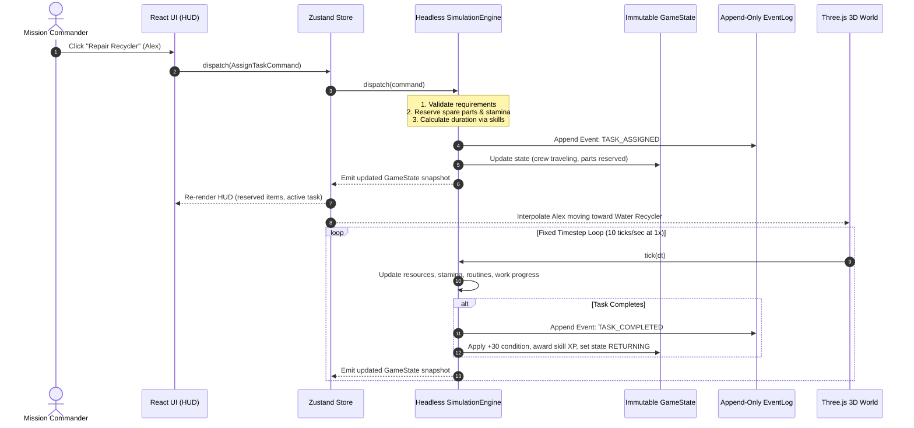
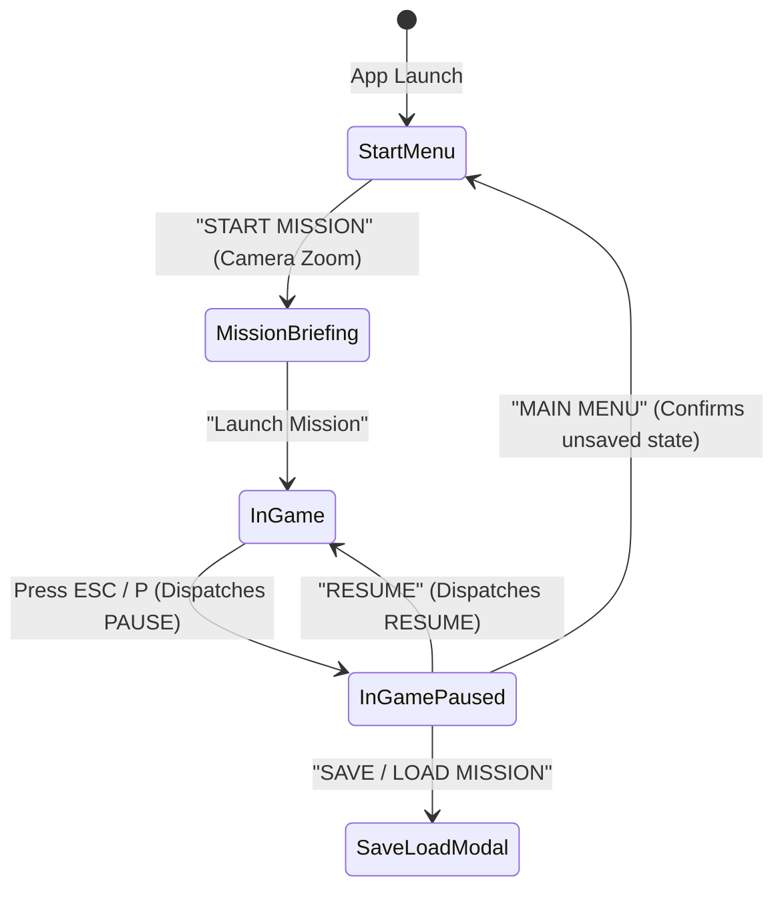
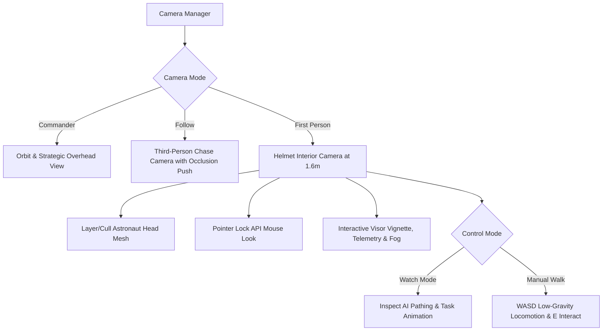
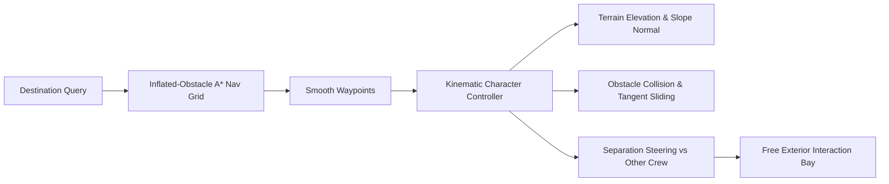

# Lunar Frontier: The Last 30 Days — Architecture Specification

## 1. Vision & Architectural Principles

**Lunar Frontier: The Last 30 Days** is an authentic 3D lunar-base survival and base-management simulation set at the Moon's South Pole.

The architecture strictly adheres to five core rules:
1. **Zero UI Authority**: Neither the React UI nor the Three.js 3D renderer may ever modify resources, complete tasks, or manipulate astronaut states. The UI only sends validated command objects; the simulation engine alone mutates state.
2. **Headless & Deterministic Core**: The simulation core (`src/sim/`) is pure TypeScript. It has zero dependencies on DOM, WebGL, Phaser, or `Date.now()`. It runs headlessly in Node.js and inside Vitest automated test bots.
3. **Fixed-Timestep Simulation Loop**: The engine runs at a fixed tick rate (10 ticks per real second at 1× speed, or 24 ticks/day in discrete mode). Time controls (Pause, 1×, 2×, 4×) adjust how many fixed ticks advance per frame, never the tick duration.
4. **Command & Event-Sourcing Pattern**: All player interactions are discrete, serializable `Command` objects. Every significant state change is written to an append-only `EventLog` that acts as the single source of truth for telemetry, astronaut work history, notifications, and end-of-day/mission reports.
5. **Data-Driven Balance**: All gameplay numbers (consumption rates, capacities, crop durations, power loads, skill efficiency multipliers) live in `/data/balance.json` and are validated at runtime using Zod schemas.

---

## 2. Directory & Package Layout

```text
├── data/                       # Validated JSON data configurations
│   ├── balance.json            # Resource rates, capacities, solar curves, difficulty scales
│   ├── buildings.json          # Building definitions, upgrade tiers, maintenance costs
│   ├── crew.json               # Astronaut stats, starting skills, personality traits
│   ├── research.json           # Research project tree, requirements, and tech unlocks
│   └── events.json             # Event director specifications, severities, and choices
│
├── docs/                       # Technical and gameplay documentation
│   ├── ARCHITECTURE.md         # Architecture, data flow, and module boundaries
│   ├── DECISIONS.md            # Architecture & balance decision records
│   └── BACKLOG.md              # Scope-creep parking lot (V2+ ideas)
│
├── src/
│   ├── sim/                    # HEADLESS SIMULATION CORE (Zero DOM/Zero 3D)
│   │   ├── types.ts            # Complete TypeScript types and interfaces
│   │   ├── rng.ts              # Deterministic Mulberry32 seeded PRNG
│   │   ├── schema.ts           # Zod schema validators for data configs & save states
│   │   ├── commands.ts         # Command definitions, validation, and dispatcher
│   │   ├── events.ts           # Event log emitter and history derivations
│   │   ├── save.ts             # Versioned serialization, migration hooks, and autosave
│   │   ├── engine.ts           # Central SimulationEngine coordinator
│   │   └── rules/              # Subsystem simulation rules
│   │       ├── resource.ts     # Water, oxygen, food, power rate equations & clamps
│   │       ├── power.ts        # Solar generation, battery storage, and priority load-shedding
│   │       ├── crew.ts         # Health, stamina, morale, skills, routines, and traits
│   │       ├── tasks.ts        # Task state machine, durations, reservations, and failures
│   │       ├── buildings.ts    # Condition, dust accumulation, maintenance, and upgrades
│   │       ├── research.ts     # Tech tree progression and unlock effects
│   │       ├── rover.ts        # Surface expeditions, sample retrieval, and risk
│   │       └── lunar.ts        # Dust storms, thermal swings, CO2 scrubbers, solar storms
│   │
│   ├── game3d/                 # THREE.JS / REACT THREE FIBER PRESENTATION
│   │   ├── World.tsx           # WebGL Canvas container and fixed-timestep accumulator
│   │   ├── Terrain.tsx         # Lunar heightmap, craters, and regolith shaders
│   │   ├── Lighting.tsx        # South Pole solar elevation angle & dynamic shadows
│   │   ├── CameraRig.tsx       # Orbit, follow-astronaut, and jump-to-facility camera
│   │   ├── ModelLoader.tsx     # Three.js GLTF / GLB model loader & clone manager
│   │   ├── Buildings/          # 3D modular building models & status indicators
│   │   ├── Crew.tsx            # Animated astronaut avatars, pathing, and tool props
│   │   └── Rover.tsx           # 6-wheel rover surface traversal & sampling pathing
│   │
│   ├── ui/                     # REACT DOM HUD OVERLAY (DOM Only)
│   │   ├── Hud.tsx             # Root HUD layout coordinator
│   │   ├── MissionBar.tsx      # Top NASA telemetry bar (time, day, speed, resources)
│   │   ├── ResourceDashboard.tsx # Compact resource strip with days-remaining net rates
│   │   ├── LeftNavPanel.tsx    # 44px icon rail with drawer panels for all subsystems
│   │   ├── AstronautRoster.tsx # Bottom crew switcher [1-4] with health/stamina/morale meters
│   │   ├── ContextPanel.tsx    # Right inspector drawer (Building, Crew, Rover details)
│   │   ├── TaskMenu.tsx        # Task assignment dialog with cost preview & success odds
│   │   ├── NotificationTray.tsx# Auto-dismissing alerts with severity levels & spam control
│   │   └── SaveLoadModal.tsx   # Multi-slot save/load manager with difficulty selection
│   │
│   └── store/                  # Client-side presentation state
│       ├── store.ts            # Zustand store holding simulation snapshot & UI toggles
│       └── bus.ts              # Lightweight pub/sub event bus for UI sound/camera cues
│
└── tests/                      # AUTOMATED TESTS & SIMULATION BOTS
    ├── sim.determinism.test.ts # Seeded Mulberry32 reproducibility tests
    ├── sim.travel.test.ts      # Astronaut movement & base grid travel ticks
    ├── sim.bounds.test.ts      # Resource clamping & shortage logic
    ├── sim.scoring.test.ts     # Mission evaluation & end rank criteria
    ├── sim.features.test.ts    # Building upgrades, research, and greenhouse cycles
    ├── sim.save.test.ts        # Serialization, schema validation, and mid-task resume
    └── balance-bot.test.ts     # Headless 1,000-game playthrough balance bot
```

---

## 3. Data Flow Architecture



---

## 4. Single Source of Truth: Time, Units, and Scales

| System | Units | Range / Precision | HUD Display |
|---|---|---|---|
| **Simulation Timestep** | 1 tick = 1 game minute | Fixed deterministic step | Day X, HH:MM |
| **Day Duration** | 1 game day = 24 game hours = 1440 min | Configurable (10 min real-time at 1×) | Day Progress bar |
| **Astronaut Health** | Health points | 0 to 100 | Percentage meter & status pill |
| **Astronaut Stamina** | Work stamina points | 0 to 100 (resets upon sleep) | Colored gauge & remaining hours |
| **Astronaut Morale** | Morale points | 0 to 100 | Psychological condition pill |
| **Food Storage** | Rations | 0 to 150 rations | Gauge + Days remaining at current rate |
| **Water Storage** | Litres ($L$) | 0 to 600 $L$ | Gauge + Days remaining at current rate |
| **Oxygen Storage** | Kilograms ($kg$) | 0 to 200 $kg$ | Gauge + Days remaining at current rate |
| **Power Storage** | Kilowatt-hours ($kWh$) | 0 to 60 $kWh$ (battery cap) | Gauge + Storage capacity % |
| **Power Flow Rate** | Kilowatts ($kW$) | Net balance = generation - load | Net flow indicator ($+kW$ / $-kW$) |
| **Skills** | Discrete Levels | 1 to 10 per category | Skill level badges & XP progress bar |

---

## 5. Technology Stack Decisions

- **Language**: TypeScript 5.8 with `strict: true`, `noImplicitAny: true`.
- **Simulation**: Pure TypeScript with seeded Mulberry32 PRNG.
- **Data Validation**: Zod 3.24 for runtime JSON configuration and save-state schema validation.
- **Rendering**: Three.js 0.174 + `@react-three/fiber` 8.18 + `@react-three/drei` 9.122.
- **Client State**: Zustand 5.0 for clean separation of UI state from simulation state.
- **Testing**: Vitest 3.0 for fast headless unit tests, integration tests, and 1,000-run balance bots.
- **Styling**: Tailwind CSS 3.4 for modular NASA telemetry theme styling.

---

## 6. Menu & Lifecycle Architecture (Start & Pause Menus)



1. **Start Menu Lifecycle**:
   - The Start Menu is rendered before entering the main simulation. It mounts a dedicated, lightweight Three.js canvas (`StartMenuCanvas`) with a rotating NASA Moon, distant Earth, satellite orbit, and 3-layer parallax starfield.
   - When "START MISSION" is triggered, a cinematic camera push transitions into the mission briefing, then unmounts the Start Menu canvas completely to reclaim 100% of GPU resources.
   - Design system tokens are centralized in `src/ui/theme.ts` (Cyan `#2EC4D6`, Warning `#FFB020`, Background `#050A14` to `#0A1424`, Chamfered `clip-path` buttons).
2. **Pause Menu Architecture**:
   - Triggered by `Escape` or `P` (or top navigation button).
   - Pausing is deterministic: the simulation tick accumulator stops, active task progress freezes, audio ducks, and a `{ type: 'PAUSE' }` command is appended to the replayable `commandLog`.
   - If the player is in First-Person View, pointer lock is immediately released on pause and restored on resume.

---

## 7. Multi-Mode Camera System & First-Person View (FPV)



- **Camera Modes**:
  1. `commander`: Orbit and zoom controls for overall base management.
  2. `follow`: Third-person follow camera positioned 3.5m behind and 1.8m above selected astronaut with sphere-cast camera collision.
  3. `first_person`: Positioned at eye height (1.6m) inside the selected astronaut's helmet.
- **Head Culling**: The astronaut's head mesh is culled from the FPV camera so the player never sees the inside of the neck or helmet shell, while arms, hands, and suit chest telemetry remain visible.
- **Watch Mode vs Manual Walk Mode**:
  - In *Watch Mode*, the camera follows the AI astronaut's physical transit and smooth gaze toward work targets.
  - In *Manual Walk Mode*, the player moves the astronaut with WASD, sprint with Shift, and interacts with `E`. Movement inputs are validated against ground elevation, low-gravity leap mechanics, and obstacle walls.

---

## 8. Authoritative Collision & Navigation Architecture



1. **Data-Driven Building Footprints**: Every facility defines a footprint boundary, obstacle collider, and dedicated exterior interaction stations (outside the building boundary).
2. **Authoritative Navigation Mesh / Grid**:
   - Grid resolution of 0.5m across the $80 \times 80$m terrain.
   - Obstacles are inflated by the agent capsule radius ($0.4$m) plus a $0.2$m safety buffer.
   - AI astronauts strictly follow A* paths through open corridors ($\ge 1.5$m) and enter airlocks only through designated door waypoints.
3. **Kinematic Character Controller & Collision**:
   - Continuous circle/box collision test with tangent wall sliding.
   - Characters snap to `getTerrainHeight(x, z)` and are blocked by slopes $> 35^\circ$.
   - Local avoidance steering prevents astronauts from overlapping.
4. **Stuck Detection**:
   - If a moving astronaut progresses $< 0.1$m over 3 seconds, a repath is executed. After 3 failed repaths, an alert is logged and the character snaps to the nearest valid corridor waypoint.
5. **Debug Overlay (`F3`)**:
   - Visualizes navmesh grid, building footprints, character capsule colliders, interaction points, and stuck telemetry.

---

## 9. Asset Licensing & Attribution Protocol

- All 3D models, textures, audio samples, and fonts must be documented in `docs/ASSETS.md`.
- Permitted licenses: NASA Open Data (public domain), CC0 (Poly Haven, ambientCG, Kenney, Quaternius), Creative Commons with attribution (Sketchfab, Pixabay, Freesound).
- In-game credits modal provides full attribution to the NASA Scientific Visualization Studio and all contributing artists.
